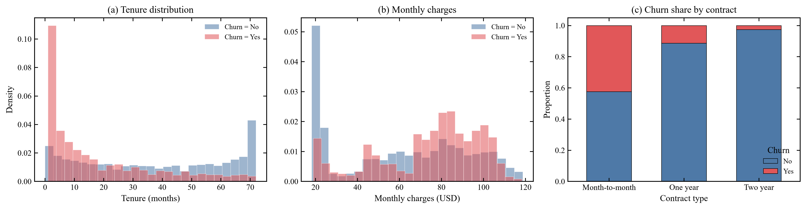
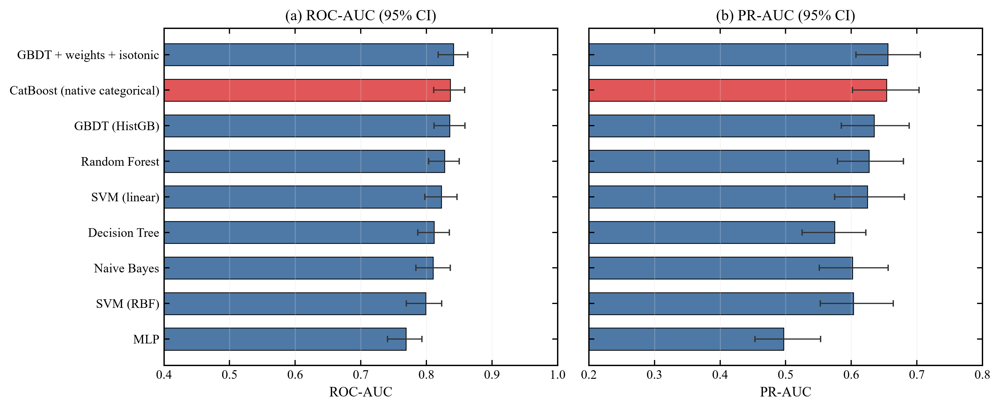
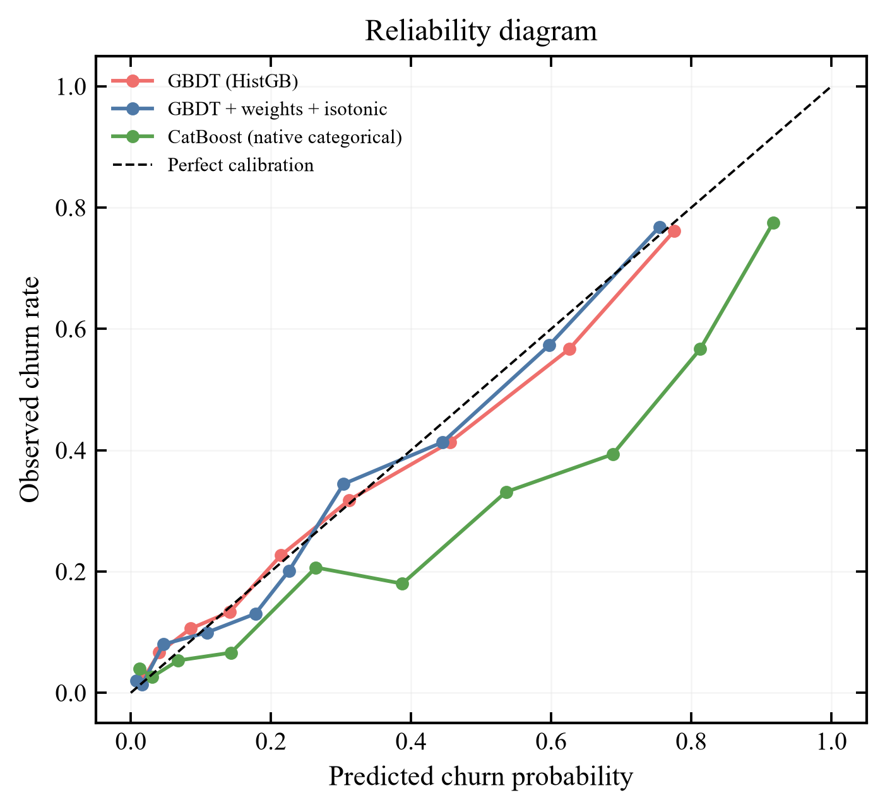
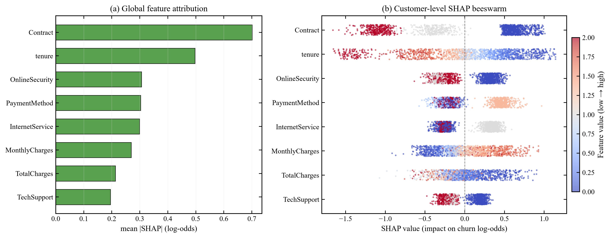
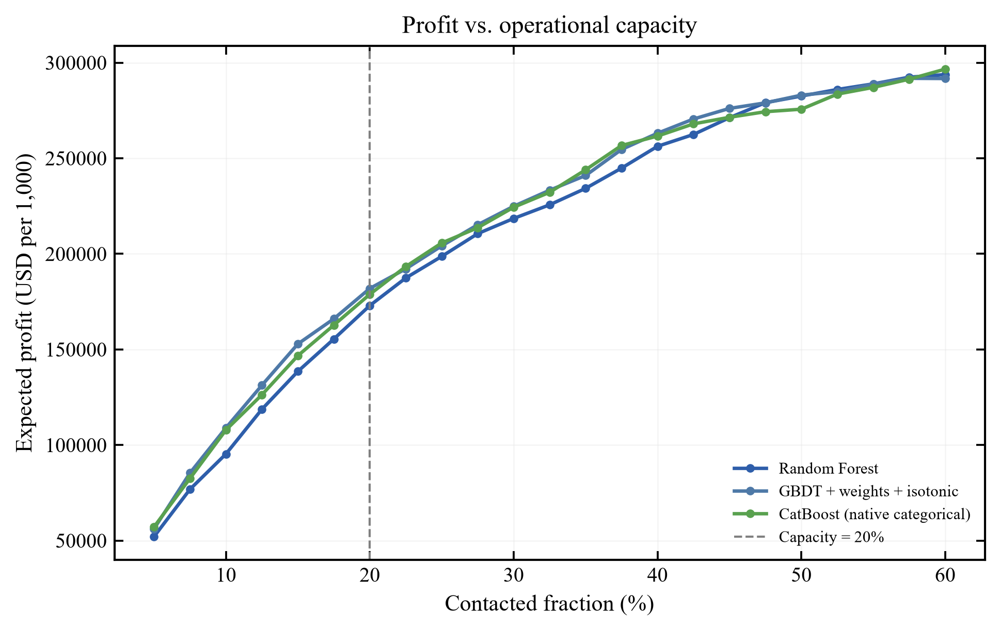
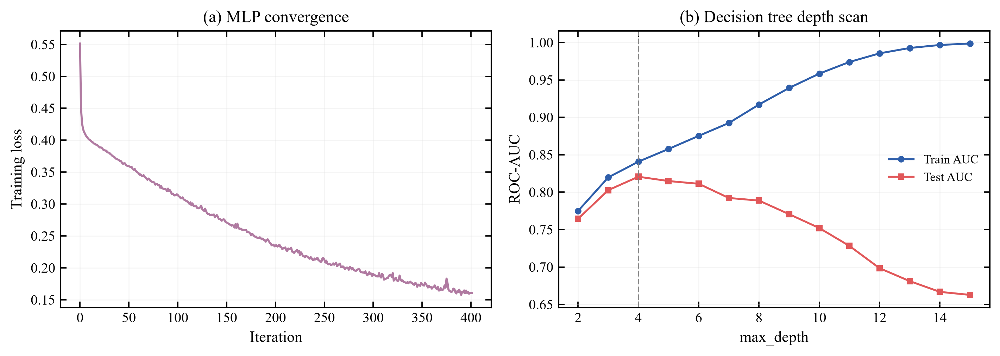
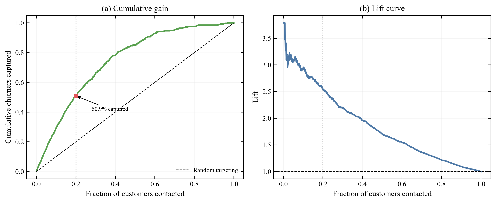

# 面向运营容量的电信客户流失预测：校准集成与阈值决策

**兰丽华**　数据挖掘课程实验报告　课程教师：高峻嘉

代码与结果仓库：https://github.com/luckylan888/data_mining

**摘要**　电信客户流失预测的准确率容易被类别不平衡掩盖，固定使用0.5阈值也缺少业务依据。本文基于6013条有效客户记录，按探索、清洗、划分、建模、评估、决策六个阶段完成建模，重点处理了TotalCharges的类型错误与结构性缺失、整行无效记录，以及该字段与在网时长、月费之间的强冗余。模型保留朴素贝叶斯、支持向量机、多层感知机、决策树和随机森林作为基准，并加入梯度提升树、等渗校准与CatBoost作为对照。分类阈值在独立验证集上按运营容量确定，测试集只评估一次。结果表明，校准后的梯度提升树取得最高AUC（0.8415）和PR-AUC（0.6556）；CatBoost直接使用类别字段并未带来提升（AUC为0.8364），说明编码方式不是当前数据的瓶颈。在每月联系20%客户的约束下，模型可覆盖50.9%的流失客户，提升度为2.54，期望利润约为18.2万美元/千人。SHAP分析显示，月付合同、短在网时长与缺少技术支持是高风险的主要来源，据此提出合约迁移、新客90天回访和服务包捆绑三类动作。

关键词　客户流失；类别不平衡；概率校准；CatBoost；SHAP；决策阈值

## 1 引言

电信行业的获客成本远高于存量维系，客户一旦离网，损失的不只是当月资费，还包括后续生命周期的收入。因此运营商希望提前识别高风险客户，把有限的挽留预算投向最可能流失、也最值得挽留的人群。这类问题在数据挖掘课程里常被当成二分类练习，但真到用的时候，决定模型值不值钱的往往不是多那一两个点的准确率，而是概率可不可信、阈值合不合运营容量、结论能不能变成具体动作。

本文使用课程提供的Telco客户数据，共6014条记录、21个字段，其中流失客户占26.4%。数据中存在几处容易被忽略的问题：TotalCharges被存成文本并混入空白字符串，末尾有一条只剩客户编号和性别的无效记录，该字段还与在网时长和月费几乎完全共线。若直接调用dropna或均值填充，这些问题会被掩盖，后续的模型比较也失去意义。

做法上有几处和常见套路不一样。预处理固定成“先划分、后拟合”，补值、编码和缩放都封在流程里，免得测试信息提前漏进去。模型除了课程要求的五个基准，另外加了梯度提升树、概率校准和CatBoost做对照，想看看“让树直接处理类别字段”到底划不划算。阈值没有沿用0.5，而是放到独立验证集上按运营容量和单客账来算，测试集只在最后评一次，不来回试。

## 2 数据探索与问题定位

样本的流失比例为26.4%，95%置信区间为25.3%至27.5%，正负样本比约为1比2.8。这意味着全部预测为“不流失”即可得到73.6%的准确率，准确率不适合作为主指标。本文以PR-AUC和召回率为主，辅以ROC-AUC、Brier分数和对数损失，并为每个指标计算500次Bootstrap置信区间。

字段检查发现三处需要处理的问题。第一，TotalCharges的存储类型为object，直接查看缺失值只能发现1条空记录，但去除首尾空格并强制转换为数值后，有9条空白字符串暴露为缺失，且全部对应在网时长为0的新客户，属于结构性缺失而非随机缺失。第二，数据末尾有一条仅包含customerID和gender的记录，gender取值为“Fem”，是拼写错误，无法用于监督学习。第三，TotalCharges与tenure、MonthlyCharges的乘积高度重合，线性回归的R²达到0.9991，与这两个字段的相关系数也分别有0.82和0.65，基本是可推导的冗余字段。

分组统计给出了更直接的业务信号（图1）。月付合同的流失率为42.4%，一年合同为11.3%，两年合同只有2.6%；在网时长不足6个月的新客流失率为52.1%，而48个月以上的老客降到9.2%；使用光纤接入的客户流失率为41.8%，使用DSL的为18.7%；没有开通技术支持的客户流失率为41.7%，开通后降至14.6%。流失客户在短在网、高月费一端明显富集，也解释了后续SHAP结果为何集中在合同类型、在网时长和服务组合上。



*图1　在网时长、月费分布与不同合同的流失占比*

## 3 方法

### 3.1 清洗、划分与预处理

清洗按“记录有效性加领域规则”进行，而不是整表删除缺失。先删除没有标签的无效记录，共1条；再对TotalCharges去空格并转为数值，把在网时长为0且仍缺失的记录按业务含义补0，因为新客户尚未产生累计费用；剩余缺失保留为NaN，由流程内的中位数填充处理，并额外生成缺失指示列。这样既没有编造数据，也保留了“是否缺失”本身可能携带的信息。

数据按75比25分层划分为训练集和测试集，再从训练集切出20%作为验证集。验证集只用于选择分类阈值，测试集在全部模型确定后只评估一次。数值列的补值与标准化、类别列的独热编码都写在ColumnTransformer和Pipeline中，交叉验证时每一折重新拟合，缩放不会提前看到验证数据。类别编码使用drop first避免完全共线，并设置handle_unknown为ignore，保证测试集出现新类别时不会报错。

### 3.2 模型设置

基准模型包括高斯朴素贝叶斯、线性核与RBF核支持向量机、含64和32个单元两个隐层的多层感知机、最大深度为4的决策树，以及300棵树的随机森林。支持向量机使用默认惩罚系数C=1，线性核在4509个训练样本上有2041个支持向量，RBF核有2116个，两者都接近样本的一半。梯度提升树使用0.05学习率、400轮迭代、31个叶节点，并开启早停；其加权版本使用balanced类别权重，再用5折等渗回归校准输出概率。CatBoost使用600轮迭代、深度6，直接把合同类型、支付方式等字段作为类别特征输入，不做独热编码。

所有模型在训练集上重新拟合后用于测试集评估，阈值仍取自验证集。为判断稳定性，本文对朴素贝叶斯、线性支持向量机、随机森林、梯度提升树、校准模型和CatBoost做了5折交叉验证，其余模型只报告单次划分结果，报告时会说明这一差异。

### 3.3 阈值与利润模型

运营团队每月能触达的客户比例有限，本文取20%作为容量约束，在验证集上取风险分数的80%分位数作为阈值，再原样应用到测试集。利润模型沿用流失文献的常见设定：成功挽留一名客户带来的收益为24个月月费乘以挽留成功率，挽留成功率用训练集留存率0.7356近似；每次触达的成本按50美元优惠计算。由此得到每千名客户的期望利润，用于比较不同模型在同一容量下的经济价值。

## 4 实验结果

表1汇总了各模型在测试集上的表现。校准后的梯度提升树在AUC和PR-AUC上均排名第一，分别为0.8415和0.6556，5折交叉验证AUC为0.8438，标准差0.0146。CatBoost的AUC为0.8364，PR-AUC为0.6539，交叉验证均值0.8386，三项都略低于独热编码加梯度提升树的组合，但差距在置信区间之内。随机森林的AUC为0.8277，线性支持向量机为0.8228，RBF核降到0.7990。朴素贝叶斯的排序能力尚可（AUC为0.8101），但Brier分数高达0.3288，对数损失为2.4407，说明其输出的概率明显过度自信。多层感知机表现最弱，AUC仅0.7691。

*表1　测试集上的模型指标（阈值来自验证集）*

| 模型 | AUC | PR-AUC | 召回 | 精确率 |
| --- | --- | --- | --- | --- |
| GBDT+等渗校准 | 0.8415 | 0.6556 | 0.5567 | 0.6332 |
| CatBoost | 0.8364 | 0.6539 | 0.4987 | 0.6899 |
| GBDT | 0.8354 | 0.6350 | 0.5668 | 0.6285 |
| 随机森林 | 0.8277 | 0.6269 | 0.5542 | 0.6377 |
| SVM线性核 | 0.8228 | 0.6246 | 0.5567 | 0.6022 |
| 决策树 | 0.8118 | 0.5744 | 0.5239 | 0.6082 |
| 朴素贝叶斯 | 0.8101 | 0.6020 | 0.5264 | 0.6076 |
| SVM径向基核 | 0.7990 | 0.6034 | 0.5567 | 0.6278 |
| 多层感知机 | 0.7691 | 0.4967 | 0.4912 | 0.5342 |

图2把AUC与PR-AUC放在同一坐标上并给出置信区间，可以看出排名靠前的几个模型高度重叠。校准模型与CatBoost的PR-AUC区间分别为0.607至0.705和0.602至0.703，单次划分的差距不足以支撑“谁显著更好”的判断，ROC与PR曲线在大部分区间也几乎重合，差异主要出现在低召回区域。



*图2　各模型的ROC-AUC与PR-AUC（含95%置信区间）*

业务指标换了一个视角。表2显示，线性支持向量机在自身阈值下的利润为20.8万美元/千人，校准模型为19.6万美元；把容量统一固定为20%后，前者为18.80万美元、后者为18.19万美元，差距约3%。线性支持向量机的利润略高，但它的概率没有校准，Brier分数为0.1431，交叉验证AUC也低0.0066，二者差距小于Bootstrap区间宽度。阈值需要迁移到不同月份，预算分配也依赖可信的概率，因此本文选择校准模型作为上线建议。校准模型在前20%容量下抓到50.9%的流失客户，提升度为2.54。

*表2　20%运营容量下的业务指标（美元/千人）*

| 模型 | 触达率 | 召回 | 利润@阈值 | 利润@20% |
| --- | --- | --- | --- | --- |
| SVM线性核 | 24.4% | 55.7% | 207,960 | 188,028 |
| GBDT+等渗校准 | 23.2% | 55.7% | 196,215 | 181,894 |
| GBDT | 23.8% | 56.7% | 196,606 | 178,841 |
| CatBoost | 19.1% | 49.9% | 174,670 | 178,822 |
| 随机森林 | 22.9% | 55.4% | 189,545 | 172,935 |
| 朴素贝叶斯 | 22.9% | 52.6% | 188,336 | 171,700 |

图3的可靠性曲线解释了为何优先选校准模型：等渗校准后的GBDT最贴近对角线，CatBoost整条偏低，概率系统性偏高。按概率分配预算时，这种偏差会直接扭曲触达名单，所以校准不只是指标好看，而是可用性的前提。



*图3　校准前后的可靠性曲线（越贴近对角线越好）*

CatBoost直接使用原始类别字段，省去独热编码，理论上更适合高基数类别，但这里并未超过独热加梯度提升树的组合，AUC低0.005、PR-AUC低0.002。原因大致是：类别基数都不高（合同3类、支付方式4类），独热不会造成维度爆炸；600轮迭代和默认正则化没针对本数据调参；类别加权后概率偏高，阈值被推到0.7614，触达率降到19.1%。可见编码方式的收益要看数据形态，不能把模型宣传的默认优势当结论。

图4给出CatBoost的全局SHAP重要性。合同类型的影响最大，其次是在网时长，然后是网络安全服务、支付方式与接入方式。高风险组中月付合同占99.7%，全体为55.3%；高风险组在网时长中位数为6个月，全体为29个月；高风险组有94.1%没有开通技术支持，全体为51.8%。这些差异与第2节的分组统计一致，说明模型学到的是稳定的业务结构，而不是偶然的噪声。



*图4　CatBoost的全局SHAP重要性*

图5的利润曲线随容量上升，但40%后斜率明显变缓：高风险人群集中在排序前端，扩大触达后新增人群流失率接近总体水平，扣除50美元成本后的净增有限。校准模型与GBDT曲线几乎重合，CatBoost位置最低，与表2一致。



*图5　利润随运营容量的变化*

## 5 理论分析

### 5.1 朴素贝叶斯的条件独立假设

朴素贝叶斯把后验概率写成先验与各特征条件概率的连乘，即P(y|x)正比于P(y)乘以所有P(x_j|y)。这一分解默认在给定类别后各特征相互独立。Telco数据显然不满足该假设：网络安全、在线备份、设备保护、技术支持与接入方式由同一份套餐决定，条件于流失与否仍然高度相关。独立性不成立时，同一份证据会被重复计入，连乘结果被推向0或1，概率因此过度自信。实验结果与此吻合：朴素贝叶斯的AUC仍有0.8101，说明排序方向大体正确，但Brier分数为0.3288、对数损失为2.4407，分别是校准梯度提升树的2.4倍和5.8倍；在验证阈值0.9998下准确率为0.7846，召回率为0.5264。因此它可以作为快速基线或排序器，但不适合直接输出概率用于利润计算。

### 5.2 RBF核与线性核的比较

线性核在原始特征空间寻找一个超平面，RBF核则通过高斯函数把样本映射到无穷维空间，理论上能拟合更复杂的边界。本文的结果相反：线性核AUC为0.8228，RBF核为0.7990；线性核的支持向量为2041个（占训练集的45.3%），RBF核为2116个（46.9%）。独热编码后的特征维度约40维，类别边界接近线性，线性核已经能够分开大部分样本；RBF多出的容量没有用于降低偏差，反而拟合了训练集中的局部噪声。RBF的核宽度由gamma控制，默认值随特征方差变化，在稀疏的独热向量上容易过小，导致每个支持向量的影响范围过窄。支持向量比例接近也说明RBF没有找到更紧凑的边界。若业务方需要解释系数方向，线性核还具备RBF不具备的可读性。

### 5.3 多层感知机的损失收敛与XOR问题

单层感知机只能表示线性决策面，无法解决XOR。本文用四个XOR样本做了对照：逻辑回归的准确率为0.5，加入一个含4个tanh单元的隐层后，多层感知机达到1.0。隐层的作用是把输入组合成新的中间表示，使原本线性不可分的问题在新空间中可分。本文的MLP使用64和32个单元，训练402轮后损失从0.5514降到0.1604，曲线后段基本走平（图6a），说明在给定学习率与迭代上限下已经收敛。但测试AUC只有0.7691，是全部模型中最差的。损失收敛只说明优化过程完成，不代表泛化能力；样本量约4500、输入是稀疏独热向量、网络容量相对任务偏大，都是可能的过拟合来源。若要做得更稳，应加入L2正则或早停，并用验证损失而不是训练损失选轮次。



*图6　(a)MLP训练损失收敛曲线；(b)决策树深度扫描，深度4之后测试AUC下降*

### 5.4 随机森林为何比单棵树稳定

单棵决策树对训练样本的扰动很敏感：某个分裂点换了一批样本就可能改变，方差因此较大。Bagging对B棵树取平均，方差可写为ρσ²加(1-ρ)σ²/B，其中ρ是树间相关系数。随机森林在每次分裂时只考虑随机抽取的特征子集，使树之间的相关性下降，从而压低第二项；同时每棵树仍是有偏、但方差不会爆炸的模型，平均后方差下降而偏差基本不变。本文固定测试集，重复抽取10个训练子集后，单棵树的AUC为0.8102±0.0046，随机森林为0.8251±0.0042，均值提高约0.015，波动也有所下降。降幅不大，是因为特征只有约40维、树已按图6b的深度扫描限制在4层，树间相关性仍然偏高。主实验中随机森林的AUC为0.8277，高于单棵树的0.8118，与上述分析一致。

## 6 业务取舍与挽留建议

从模型输出到运营动作，还差一步把风险分数翻译成人群和策略。按20%容量计算，校准模型每月可覆盖约五分之一的客户，抓到其中50.9%的流失客户，精确率为63.3%，即每联系100人约有63人确实会流失。相比随机触达，同样的预算可以多挽回约1.5倍的客户。若把容量放宽到30%，捕获率升到66.5%，利润由18.2万升到22.5万美元；但继续扩大时增量迅速缩小，从40%到50%只多2.0万，从50%到60%不足0.9万。考虑到触达人力与客户体验，本文仍把20%作为基准容量，30%可作为预算充足时的备选。



*图7　(a)累积增益曲线；(b)提升度曲线，虚线为20%容量处*

图7的增益与提升度曲线印证了这一点：前20%容量就捕获50.9%的流失客户、提升度约2.5，之后提升度一路回落到接近1。预算因此应集中在高分位人群，而不是平均撒网。

高风险画像集中在三类人：月付合同、在网不足一年、没有开通技术支持。对应的动作可以分开设计。对月付客户，推年付或两年合约并给出首年折扣，直接改变模型中权重最大的风险因素；对新客，把前90天拆成若干触点，在第一个月内完成套餐确认与使用指导，避免“办完即走”；对缺少安全与支持服务的客户，用安全加支持的增值包提高转移成本，而不是单纯降价。这些动作都对应模型中的可干预变量，而不是性别、地区之类无法改变的特征。

需要说明的是，SHAP给出的是关联而非因果。模型认为合同类型重要，不代表把客户改成两年合约就一定能降低同样的流失概率。上线前应做小规模随机对照试验，把人群按风险分层后随机分入干预组与对照组，用实际留存率验证干预效果，再决定是否扩大预算。

## 7 局限与结论

本文的结论受限于单次数据划分和单一数据集。虽然使用了Bootstrap区间和5折交叉验证，测试集仍然只有1504条记录，模型排名的置信区间大量重叠。利润模型中的留存率0.7356与24个月生命周期是近似值，更换行业或优惠成本后，最优容量可能移动。此外，数据缺少时间维度，无法做跨期验证，概念漂移的风险没有被度量。

这次实验做下来，收益其实不在多堆几个模型，而在把预处理顺序、阈值选择和解释这几步做扎实。校准后的梯度提升树在统计指标和业务利润之间比较平衡；CatBoost的原生类别处理没带来提升，说明编码方式得看数据形态；朴素贝叶斯和RBF核表现不佳，分别卡在条件独立假设太强和容量过剩上。交给运营方的话，20%容量、0.478阈值和那三类人群策略，是可以直接拿去讨论的起点。

## 参考文献

[1] Burez J, Van den Poel D. Handling class imbalance in customer churn prediction[J]. Expert Systems with Applications, 2009, 36(3): 4626-4636.

[2] Amin A, et al. Comparing oversampling techniques to handle the class imbalance problem: A customer churn prediction case study[J]. IEEE Access, 2016, 4: 7940-7957.

[3] Prokhorenkova L, Gusev G, Vorobev A, et al. CatBoost: Unbiased boosting with categorical features[C]. NeurIPS, 2018.

[4] Xu T, et al. Telecom churn prediction system based on ensemble learning using feature grouping[J]. Applied Sciences, 2021, 11(11): 5052.

[5] Sikri A, et al. Enhancing customer retention in telecom industry with machine learning driven churn prediction[J]. Scientific Reports, 2024.

[6] Asif M, et al. A data-driven approach with explainable artificial intelligence for customer churn prediction in the telecommunications industry[J]. Results in Engineering, 2025.

[7] The hidden costs of 99% accuracy: A trustworthiness audit of the Telco customer churn benchmark[R]. arXiv:2610.00118, 2026.

[8] e-Profits: A business-aligned evaluation metric for profit-sensitive customer churn prediction[R]. arXiv:2507.08860, 2025.

[9] Lundberg S M, Lee S I. A unified approach to interpreting model predictions[C]. NeurIPS, 2017.

## 附录A 小组分工

*表3　任务分工（本人独立完成，按任务书角色拆分记录）*

| 角色 | 负责内容 | 成员 |
| --- | --- | --- |
| A | 数据探索、缺失诊断与预处理流程 | 兰丽华 |
| B | 朴素贝叶斯、SVM、MLP及理论分析 | 兰丽华 |
| C | 基线、树模型、评估与报告、代码走查 | 兰丽华 |

## 附录B 代码走查记录

*表4　代码走查发现的问题与处理*

| 问题 | 位置 | 处理 |
| --- | --- | --- |
| TotalCharges空白串漏检 | 数据清洗 | strip后转数值，区分结构性缺失 |
| 缩放补值早于划分 | 预处理 | 移入Pipeline，每折重拟合 |
| CatBoost克隆报错 | 模型封装 | 包装器在fit时实例化 |
| 阈值在测试集上调 | 评估 | 改用验证集选阈值，只评一次 |

## 附录C AI使用声明

本报告在完成过程中使用了AI编程助手，用途限于三类：一是查询scikit-learn与CatBoost的接口用法并定位报错；二是对绘图和排版代码提供修改建议；三是对文字表达做润色。实验设计、特征处理方案、模型参数选择、结果核验与结论均由本人完成。文中所有数字来自项目内的churn_pipeline.py及其输出文件，未使用AI生成、篡改或补全实验数据。AI未参与数据采集，也未代替本人判断模型取舍。若对代码或结果有疑问，可按仓库中的脚本复现全部实验。

## 复现方式

```bash
pip install pandas numpy scipy matplotlib scikit-learn catboost
python churn_pipeline.py
```

脚本从课程提供的 `data/telco_churn.csv` 读取原始数据（该文件由课程分发，未随仓库提交），依次完成探索、清洗、划分、建模、评估与阈值决策，
输出 `figures/` 下的 11 张图（png + pdf）与 `results/` 下的指标文件。数据按 75/25 分层划分，
验证集只用于选阈值，测试集只评估一次。
